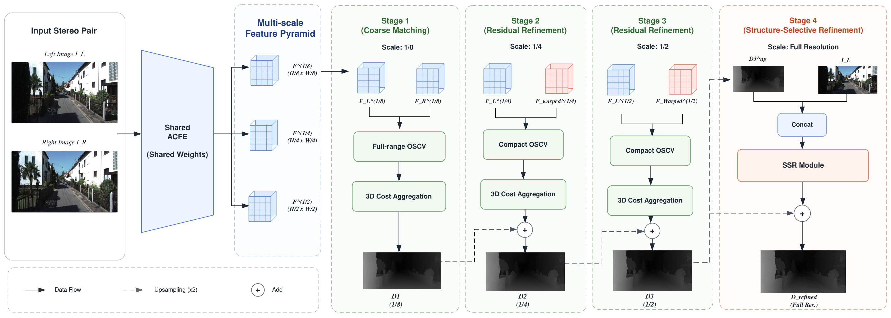

# SCSNet

SCSNet is an efficient stereo matching network for vehicular edge perception that predicts dense left-view disparity from rectified stereo image pairs.
It combines adaptive context feature extraction (ACFE), outlier-suppressed cost volumes (OSCV), and structure-selective refinement (SSR).
This repository provides the PyTorch inference code and full-model checkpoints for KITTI 2012 and KITTI 2015.



## Environment

| Component | Tested version |
| --- | --- |
| Python | 3.7.13 |
| PyTorch | 1.13.1+cu117 |
| CUDA (PyTorch build) | 11.7 |
| NumPy | 1.21.6 |
| Pillow | 9.5.0 |

## Installation

```bash
python -m pip install -r requirements.txt
```

## Pretrained weights

Both checkpoints contain the full SCSNet model.

| Dataset | Checkpoint |
| --- | --- |
| KITTI 2012 | [scsnet_kitti2012.pth](checkpoints/scsnet_kitti2012.pth) |
| KITTI 2015 | [scsnet_kitti2015.pth](checkpoints/scsnet_kitti2015.pth) |

## Inference

```bash
python infer.py \
  --checkpoint checkpoints/scsnet_kitti2015.pth \
  --left /path/to/left.png \
  --right /path/to/right.png \
  --output outputs/kitti2015 \
  --device cuda:0
```

- KITTI 2012: use `checkpoints/scsnet_kitti2012.pth` with KITTI 2012 images.
- CPU inference: use `--device cpu`.
- Inputs: rectified left/right images with the same dimensions.
- `.npy`: raw disparity in pixels.
- `.png`: 16-bit disparity, clipped to 0–192 pixels and multiplied by 256. Divide the stored values by 256 when reading.

[License](LICENSE)
